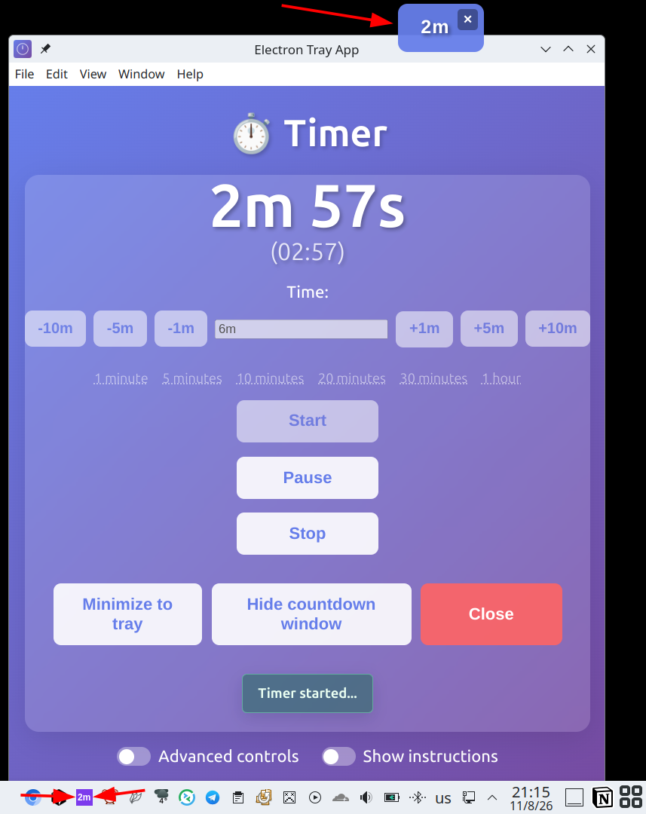

# Electron Tray Timer App (TypeScript)

A timer built with TypeScript and Electron that lives in the system tray.



## Features

- Starts minimized to the tray without opening a window
- Set a duration, then start, pause, resume, or stop the timer
- Shows the remaining time in the system tray icon
- Flashes a red icon with an exclamation mark when the timer finishes
- Closing the window minimizes the app to the tray
- Tray context menu lets you show or minimize the window, or quit the app with confirmation
- Click the tray icon to show or hide the window; double-click to open it

## Download and run

Open the repository's **Releases** page, choose the latest release, and download the archive for your operating system. Extract it and launch the app.

### Linux

Download `electron-tray-timer-1.0.0.zip`, extract it, and run:

```bash
ELECTRON_DISABLE_SANDBOX=1 ./electron-tray-timer
```

### Windows

Download and extract `Timer.Tray-1.0.0-win.zip`, then run `Tray Timer.exe`.

Windows may show a warning because the app is from an unrecognized publisher. You may also need to enable the tray's hidden icons.


### macOS

Download and use `Timer.Tray-1.0.0-mac.zip`.

## Run from source

Install dependencies:

```bash
npm install
```

Start the app:

```bash
npm start
```

For development with automatic rebuilding:

```bash
npm run dev
```

## Troubleshooting

### SUID sandbox error on Linux

If Electron reports an error involving `chrome-sandbox`, try either option:

1. Fix the file permissions (requires `sudo`):

   ```bash
   sudo chmod 4755 node_modules/electron/dist/chrome-sandbox
   ```

2. Disable the sandbox. The project scripts already set `ELECTRON_DISABLE_SANDBOX=1`.

## Project structure

- `src/main.ts` — Electron main process
- `src/index.html` — timer interface
- `dist/` — compiled files (generated automatically)

For the Russian README, see [README.ru.md](README.ru.md).
