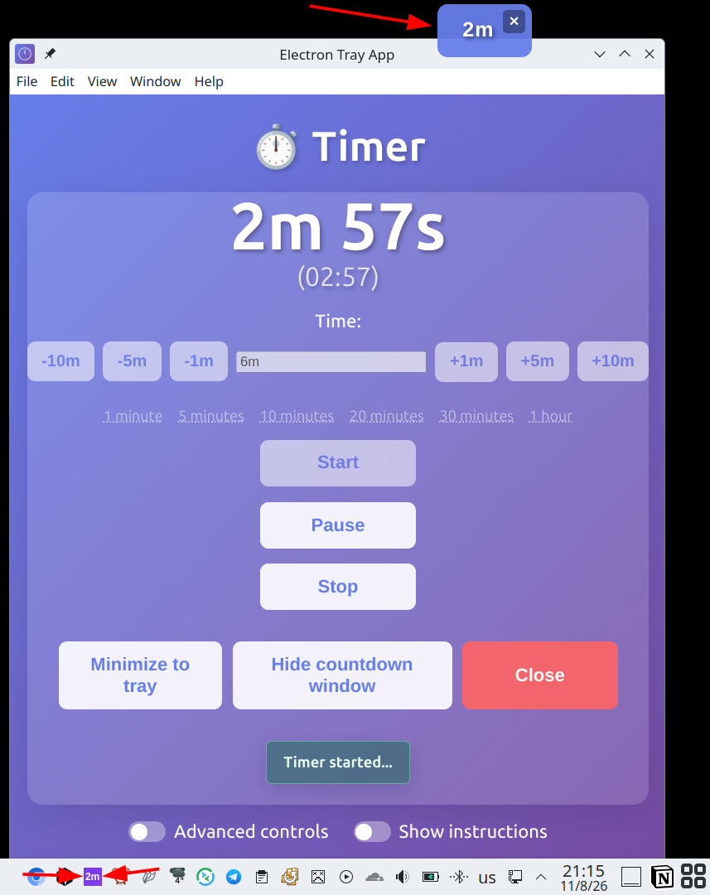

# Tray Timer

Tray Timer is a desktop countdown timer built with Electron and TypeScript. It runs in the system tray, so you can keep it available without leaving its main window open.



## What it does

- Set a duration in seconds or with units such as `25m`, `1h 30m`, or `2d`.
- Start, pause, resume, adjust, or stop the timer.
- See the remaining time in the system tray. The icon flashes red when the timer ends.
- Choose how to be notified when the timer ends: an always-on-top app window, a system notification, or both. Alarm sound and sound style are configurable.
- Open a separate countdown window and customize its format, font size, and background color.
- Customize the tray icon, main window, and section colors in Settings.
- Keep the app running in the tray when you close or minimize its main window.
- Choose whether quitting from the tray menu or the app's Close button asks for confirmation.

Click the tray icon to show or hide the main window. Double-click it to show the window. Use the tray menu to open the countdown window or quit the app.

## Download and run

Open the repository's **Releases** page, download the archive for your operating system, and extract it.

- **Windows:** launch `Tray Timer.exe`. If the tray icon is not visible, check the hidden icons area. Windows may show a security prompt because the app is not signed by a recognized publisher.
- **Linux:** launch the `electron-tray-timer` executable from the extracted folder.
- **macOS:** launch the app from the downloaded archive.

The screenshots below show the Windows security prompt, launch prompt, and tray icon location.


## Run from source

Install the dependencies and start the app:

```bash
npm ci
npm start
```

`npm start` builds the TypeScript files and then launches Electron. `npm run dev` does the same. To build without launching the app, run `npm run build`.

## Development commands

```bash
npm run typecheck     # Check application and test TypeScript
npm run lint          # Run ESLint
npm run format:check  # Check formatting
npm run test:unit     # Build and run unit tests
npm run test:e2e      # Run Playwright end-to-end tests
npm run build:electron # Package the app for the current platform
```

## Settings and portable mode

Settings are saved in `settings.json`. The repository and packaged app include a `portable-mode` marker. When the marker's directory is writable, settings are stored next to it. This keeps settings with the app folder. If that directory is read-only, the app uses Electron's per-user `userData` directory instead.

To always use the per-user location in a packaged build, remove `portable-mode` from the app resources. When the app selects a new settings location, it migrates an existing settings file from supported older locations if the destination does not already have one.

Set `TIMER_SETTINGS_PATH` to choose a specific settings file, for example when running tests:

```bash
TIMER_SETTINGS_PATH=/tmp/timer-settings.json npm start
```

## Troubleshooting

### Linux: `chrome-sandbox` error

Electron requires the `chrome-sandbox` helper to have the ownership and permissions expected by your Linux distribution. Check the helper and required system libraries if Electron reports a sandbox error. The app does not disable Chromium's sandbox.

## Project layout

- `src/main.ts` — Electron main process, tray, windows, and timer lifecycle
- `src/renderer.ts` — main window behavior
- `src/countdown.html` — floating countdown window
- `src/settings.html` and `src/settings-renderer.ts` — settings window
- `src/settings.ts` — settings validation and persistence types
- `tests/` — unit and end-to-end tests
- `dist/` — generated build output; do not edit it directly

For the Russian version, see [README.ru.md](README.ru.md).
