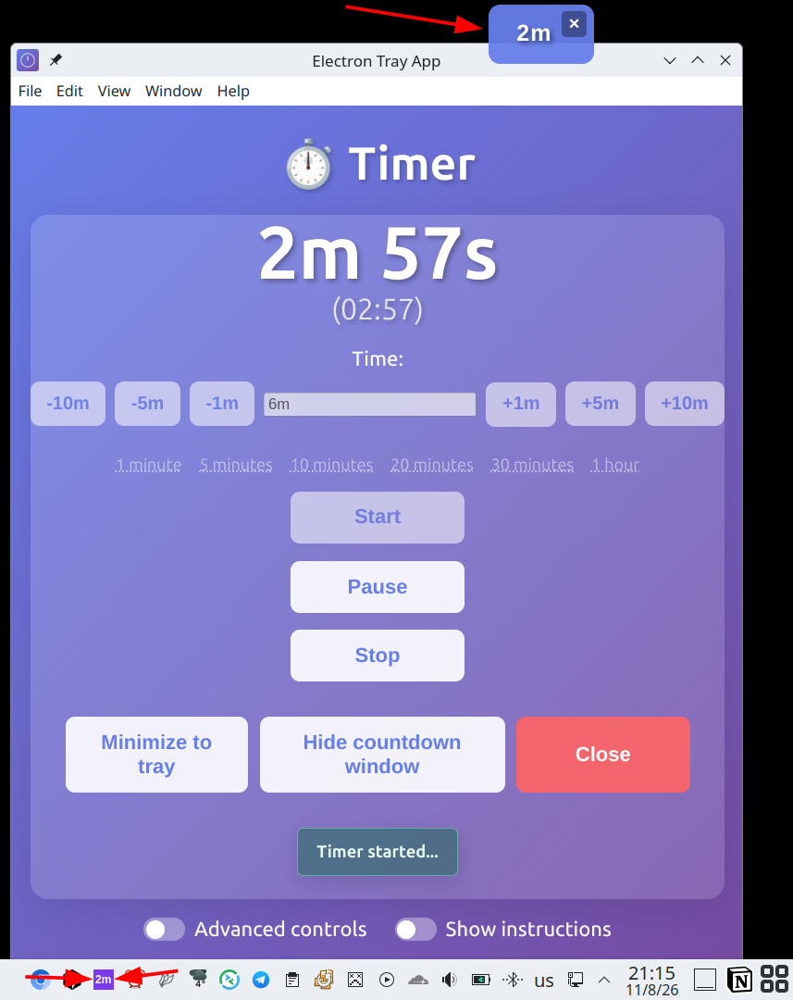

# Tray Timer

Tray Timer — настольный таймер обратного отсчёта на Electron и TypeScript. Приложение работает в системном трее, поэтому его можно оставить запущенным, не держа главное окно открытым.



## Возможности

- Задайте длительность в секундах или с единицами измерения: `25m`, `1h 30m` или `2d`.
- Запускайте, приостанавливайте, продолжайте, корректируйте или останавливайте таймер.
- Следите за оставшимся временем по значку в трее. Когда время истекает, значок мигает красным.
- Выберите способ уведомления: окно приложения поверх других окон, системное уведомление или оба варианта. Можно настроить звук и его вариант.
- Открывайте отдельное окно обратного отсчёта и настраивайте формат времени, размер шрифта и цвет фона.
- Меняйте цвета значка в трее, главного окна и секций в настройках.
- Закрывайте или сворачивайте главное окно, оставляя приложение в трее.
- Настройте, нужно ли подтверждение выхода через меню трея или кнопку закрытия приложения.

Щёлкните по значку в трее, чтобы показать или скрыть главное окно. Двойной щелчок открывает его. Через меню трея можно открыть окно обратного отсчёта или завершить работу приложения.

## Скачать и запустить

Откройте раздел **Releases** репозитория, скачайте архив для своей операционной системы и распакуйте его.

- **Windows:** запустите `Tray Timer.exe`. Если значок приложения не виден, проверьте область скрытых значков. Windows может показать предупреждение, так как издатель приложения не подтверждён сертификатом.
- **Linux:** запустите исполняемый файл `electron-tray-timer` из распакованной папки.
- **macOS:** запустите приложение из скачанного архива.

Скриншоты ниже показывают предупреждение безопасности Windows, диалог запуска и расположение значка в трее.


## Запуск из исходного кода

Установите зависимости и запустите приложение:

```bash
npm ci
npm start
```

Команда `npm start` сначала собирает TypeScript, затем запускает Electron. `npm run dev` делает то же самое. Чтобы собрать проект без запуска приложения, выполните `npm run build`.

## Команды для разработки

```bash
npm run typecheck      # Проверить типы приложения и тестов
npm run lint           # Запустить ESLint
npm run format:check   # Проверить форматирование
npm run test:unit      # Собрать проект и выполнить модульные тесты
npm run test:e2e       # Выполнить сквозные тесты Playwright
npm run build:electron # Упаковать приложение для текущей платформы
```

## Настройки и portable-режим

Настройки хранятся в файле `settings.json`. При запуске из исходного кода приложение использует пользовательский каталог Electron `userData`. Команда `npm run build:electron` создаёт маркер `portable-mode` и добавляет его в ресурсы упакованного приложения. Маркер генерируется локально и не хранится в Git. Если каталог с маркером доступен для записи, файл настроек размещается рядом с ним. Если каталог доступен только для чтения, приложение использует `userData`.

Чтобы всегда использовать пользовательский каталог в упакованной версии, удалите `portable-mode` из ресурсов приложения. При выборе нового места приложение переносит существующий файл настроек из поддерживаемых старых расположений, если в целевом каталоге такого файла ещё нет.

Переменная `TIMER_SETTINGS_PATH` задаёт путь к файлу настроек, например для тестового запуска:

```bash
TIMER_SETTINGS_PATH=/tmp/timer-settings.json npm start
```

## Решение проблем

### Linux: ошибка `chrome-sandbox`

Для работы Electron вспомогательный файл `chrome-sandbox` должен иметь владельца и права доступа, ожидаемые вашим дистрибутивом Linux. Если Electron сообщает об ошибке песочницы, проверьте этот файл и наличие необходимых системных библиотек. Приложение не отключает Chromium sandbox.

## Структура проекта

- `src/main.ts` — главный процесс Electron, трей, окна и жизненный цикл таймера
- `src/renderer.ts` — логика главного окна
- `src/countdown.html` — отдельное окно обратного отсчёта
- `src/settings.html` и `src/settings-renderer.ts` — окно настроек
- `src/settings.ts` — типы и проверка настроек
- `tests/` — модульные и сквозные тесты
- `dist/` — автоматически создаваемые файлы сборки; не редактируйте их вручную

Английская версия: [README.md](README.md).
